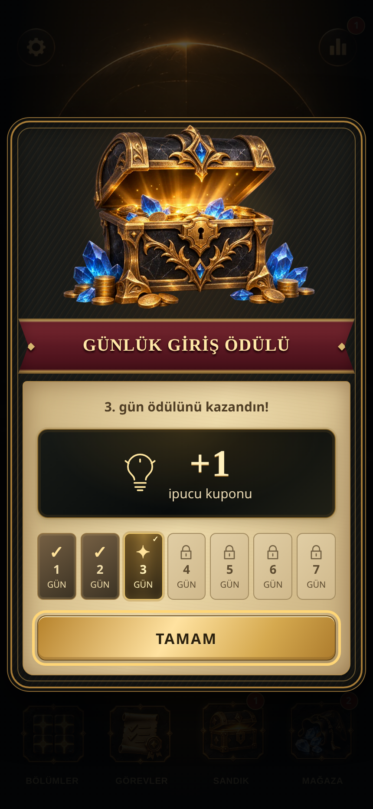
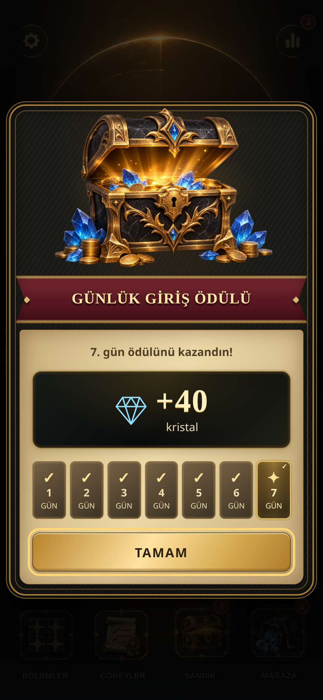
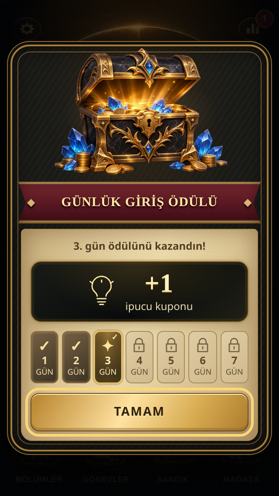

> Entegrasyon notu: Bu sayfa önceki önizlemenin arşividir. Hazine ekranı artık `6.50-treasure-energy-test1` birleşik TEST APK'sında paketlenmiştir. [Güncel APK/test raporu](../../test-builds/treasure-energy-test1-20261119/RAPOR.md).

# Günlük Giriş Ödülü — Hazine Temalı Önizleme

Bu tasarım onay bekler. Hazine ekranını içeren oyun TEST APK'sı oluşturulmadı, main'e birleştirilmedi. Boru enerjisi ayrı dalda sürdürülür; bu dal mevcut `f18a62f` enerji geliştirmelerini korur.

Kaynak dal: `design/daily-treasure-preview-20261119` · Tasarım/koruma kodu: `cc0d6029ab54ea0ba75bae12d9e8abe489acb2e6`.

## Gerçek oyun önizlemeleri

- [Üçüncü gün — +1 ipucu kuponu](day-3.png)
- [Yedinci gün — +40 kristal](day-7.png)
- [Küçük ekran — 320×568 CSS piksel](small-android-320x568.png)
- [Kısa açılış/ışık animasyonu — MP4](opening.mp4)

Görseller, gerçek oyun arayüzünde sentetik oyuncu kayıtları ve tarihlerle çekildi; reklam/mağaza görseli veya çizilmiş arayüz maketi değildir. Küçük ekran PNG'si Chromium emülasyonudur; fiziksel telefon görüntüsü değildir.

## Tasarım ve korunan sistem

Yazısız hazine görseli, mavi kristaller ve altın paralar; bordo-altın şerit, parşömen gövde, taş çerçeve; okunaklı siyah-altın ödül paneli ve geniş TAMAM düğmesi. Yedi gün tek yatay satırda; geçmiş günler onaylı, bugün vurgulu ve gelecekteki günler kilitli görünür. Ödül miktarı ve gün, mevcut oyunun `dailyLastReward` kaydından okunur. Asıl TAMAM düğümü ve kapanış işlevi korunur.

Hazine resmi 840×560 WebP, yaklaşık 119 KB. Yalnız üç kısa CSS efekti vardır; yeni parçacık motoru veya sürekli animasyon yoktur. Açılış parlaması marka ekranı kapandıktan sonra başlar. Hareketi azalt/düşük donanım yolunda animasyon yoktur. Ses, titreşim, oyun tahtası, 300 bölüm, kayıt/bulut dosyaları ve ödül miktarları değiştirilmedi.

Yedi günlük ödüller: 5 kristal, 10 kristal, 1 ipucu kuponu, 15 kristal, 20 kristal, 1 ipucu kuponu, 40 kristal.

## Testler ve sınırlar

- [Ödül/tarih/çevrimdışı ve 25 dilde 300 yerleşim kontrolü](report.json): başarılı.
- [Gerçek Chromium animasyon örnekleri ve düşük donanım/hareketi azalt kontrolü](animation-report.json): başarılı. Masaüstü ölçümüdür; Android FPS kanıtı değildir.
- 43 tarayıcı regresyon grubu; 300 bölüm ve mevcut 18 kaynak grubu; öğretici 204 yerleşim/60 tahta karşılaştırması; ses/titreşim ve UX regresyonları başarılı.
- Çok kısa/yatay ekranlarda ve bazı uzun çevirilerde kartın içi dikey kaydırılabilir; yedi günlük takvim tek yatay satırda kalır. Yazılar kesilmez, TAMAM en az 44 CSS piksel yüksekliktedir.
- Android 35 emülatörünün gerçek WebView sunum kontrolü başarılı: [üçüncü gün](android-webview-day-3.png), [yedinci gün](android-webview-day-7.png), [piksel/ödül raporu](android-webview-report.json). Kaynak `cc0d6029ab54ea0ba75bae12d9e8abe489acb2e6` yalnız test düzeneğine yüklendi; gerçek Surface görüntülerinde sandık ve mavi kristaller ölçüldü. Küçük ekran, gerçek düğme tıklaması, ödül ve tekrar giriş kontrol edildi. Bu, fiziksel POCO testi değildir. Dağıtılan boru APK'sına hazine dosyaları veya bu dalın tarih koruması dahil edilmez.

### Tarih geri alma açığı

Eski misafir akışında 19 → 20 → 19 → 20 tarihleri 500 → 515 → 520 → 530 kristale yol açıyordu. Bu, tasarımdan önce de vardı. Bu önizleme dalına geçerli son ödül tarihinden eski tarihleri reddeden küçük bir koruma eklendi: aynı senaryo artık 500 → 515 → 515 → 515. Normal ödüller, kuponlar ve seri tutarları eski sürümle karşılaştırılarak doğrulandı.

Sunucu tarafından doğrulanmış saat bulunmadığından ileri tarih sıçraması veya yerel verinin elle değiştirilmesi tamamen engellenmez. İleri alınmış son tarihten önceki tarihler ödeme yapmaz; cihaz saati düzeltilince bu tarihe yetişmek gerekebilir. Bu sınır açıkça korunur; hileye tamamen dayanıklılık iddiası yoktur.

Bu tarih düzeltmesi de onay bekleyen hazine dalındadır. Boru TEST2 APK'sının mevcut ödül motoruna karıştırılmadı.

Main/Google Play üretim 6.50/AdMob hesabı/diğer uygulamalar/mağaza görselleri değiştirilmedi. AAB oluşturulmadı veya yayımlanmadı. Yeni hazine ekranı fiziksel POCO'da test edilmedi.

Android kontrolünün başarılı çalıştırması: https://github.com/MhmTBsr60/KaraDugum/actions/runs/44466926216

Bu dal web/Android WebView önizlemesidir. Onay sonrası hazine dosyaları oyun APK varlık listesine eklenip gerçek paket içeriği ayrıca doğrulanmalıdır. Bu aşamada hazine oyun APK'sı hazırlanmadı.
