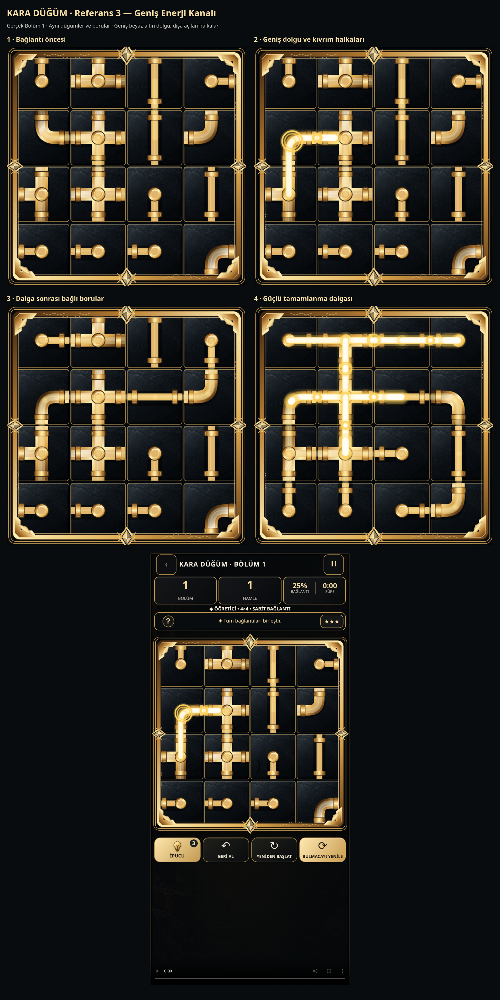

# KARA DÜĞÜM — Referans Örnek 3: Geniş Enerji Kanalı

**Yalnızca gerçek oyun motoruyla görsel/animasyon önizlemesi. TEST APK’sı/AAB üretilmedi, main’e birleştirilmedi.**

Dal: `design/energy-wave-channel-preview-20261119` · Android’de test edilen çizim commit’i: `2163547a811f8a77c97afbe2b5714966b072b4e7`.

[12 saniyelik MP4](energy-channel-12s.mp4) · [Dört büyük tahta görüntüsü](four-states.png) · [Önceki ve yeni çizim — aynı gerçek tahta, yan yana](before-after.png) · [Galeri](comparison.html)

## Referansla karşılaştırma

Esas alınan referans, kullanıcının eklediği dört örnekli görselin **sol altındaki “Örnek 3 — Enerji Dalgası”** panelidir. Referanstan oyuna aktarılan özellikler kanal genişliği, yoğun beyaz-altın dolgu, kıvrımlardaki dışa yayılan halkalar ve bağlı yol boyunca ilerlemedir. Mevcut oyun taşları ve metal boru geometrileri korunur.

| Özellik | Referansta görülen nitelik | Yeni gerçek oyun ekranı |
|---|---|---|
| Kanal genişliği | Beyaz-altın enerji iç kanalı geniş biçimde dolduruyor. | Beyaz-altın dolgu iç kanal genişliğinin %84’ü olarak çiziliyor. Altın temanın gerçek PNG kesitinde beyaz bölge yaklaşık **%76** ölçüldü. |
| Kıvrım halkaları | Borunun dirseklerinden dışarı açılan belirgin altın halkalar. | Gerçek iki ucu da bağlı dirseklerde genişleyen, katmanlı altın halkalar. Altın tema PNG’sinde metal yüzeyin dışında **852 görünür halka pikseli**; Android Surface’ında **496**. |
| Yol boyunca akış | Enerji kıvrımlı bağlı boru yolunu izliyor. | Yeni bağlantının ait olduğu gerçek bağlı bileşende fiziksel boru uzunluklarına göre sıralı akış. Ulaşılan kanal genişçe dolar; kısa ve yalıtılmış bir çizgi parçası kullanılmaz. |
| Ön ve arka ışık | Güçlü ön kısım, arkasında daha yumuşak enerji. | Parlak geniş ön kısım; ulaşılan yol üzerinde kademeli sönme ve hafif kalıcı bağlantı aydınlığı. |
| Metal ve taş | Altın metal kenarlar ve koyu taş okunuyor. | Beyaz dolgu iç kanalla sınırlı; dış halkalar ince, içi boş katmanlar. Beyazın iç kanal dışına taşması ve izin verilen dar halo dışındaki değişim testte **%0**. |
| Küçük telefon | Enerji ince ayrıntı aramadan seçilebiliyor. | [320×568 gerçek oyun görünümü](small-320x568.png); çizilen kanal yaklaşık **7,56 CSS pikseli** genişliğinde, kıvrım halkası görünür. |

Konuşmada sağlanan özgün referans görseli görsel olarak incelendi; çalışma alanında indirilebilir piksel dosyası bulunmadığından repo içindeki yan yana resmin soluna özgün referans yerleştirilmedi. **[Yan yana dosyanın](before-after.png) solu önceki reddedilen oyun çizimi, sağı yeni gerçek oyun ekranıdır.** Aynı bölüm, aynı düğüm dönüşü ve aynı motor maskeleri karşılaştırıldı. Yukarıdaki tablo özgün referansın görünüm özellikleriyle karşılaştırmadır; özgün referans yeniden çizilip gerçekmiş gibi sunulmadı.

## Dört büyük gerçek oyun görüntüsü

1. [Bağlantı kurulmadan önce — tam ekran](01-before.png) · [tahta](01-before-board.png)
2. [Geniş beyaz-altın dolgu ve kıvrım halkaları — tam ekran](02-wave-middle.png) · [tahta](02-wave-middle-board.png)
3. [Birden fazla bağlı boruda kalan hafif ışık — tam ekran](03-connected.png) · [tahta](03-connected-board.png)
4. [Bölümün tamamlanma dalgası — tam ekran](04-completion.png) · [tahta](04-completion-board.png)

[Gerçek kıvrım detayı](new-channel-detail.png) · [Önceki ve yeni tam ekran karşılaştırması](before-after.png)

## Çizim sistemi

Enerji planı, `kdConnectionModel` tarafından doğrulanmış karşılıklı uçlar ve mevcut motorun gerçek maskeleri üzerinden kuruluyor. Görsel yakınlık, hayali bağlantı veya yeni çözüm kuralı kullanılmıyor. Yayılım mesafesi gerçek boru kıvrımlarının uzunluğundan hesaplanıyor. Normal bağlantı dalgası yalnız ilgili bağlı bileşene yayılır; bağımsız ve bağlantısız parçalar yeni dalga almaz.

- Geniş sıcak altın dolgu, açık altın iç kanal ve geniş beyaz merkez katmanları; kısa koyu çerçeveli kapsül yaklaşımı kaldırıldı.
- Yalnız iki ucu da gerçekten bağlı dirseklerde dışa açılan halkalar; küçük birleşme halkaları dalga geçişine eşlik eder. Bunlar dokunma konumunda üretilen eski parlama sistemi değildir.
- Yolun ön kısmı yaklaşık **1.500 ms** içinde ilerler. Ulaşılan kanal kademeli söner; olay en çok **2.200 ms** sürer. Ardından bağlı kanallarda hafif aydınlık kalır; boşta dönen animasyon yoktur.
- Bağlantı bozulduğunda eski dalga o yolu izleyemez. Yönü değişmeyen komşunun eski kolu **240 ms** içinde söner; döndürülüp ortadan kalkan geometri hemen kaldırılır.
- Tamamlanma yalnız gerçek motorun kazanma kaydından alınır. Bağlı yollar boyunca sıralı bir tamamlanma dalgası gösterilir; sonuç paneli bu kısa görsel geçişten sonra açılır. Ödül hesabı ve verilme zamanı değişmez.
- Işık İzi kapalıyken Canvas katmanı ve tüm yeni enerji/halkalar kaldırılır. Hareketi azalt veya düşük donanımda yalnız hafif sabit bağlantı aydınlatması vardır.
- Halka sayısı yoğun tahtalarda sınırlıdır. Mevcut 20/30 çizim/saniye hedefi ve Canvas çözünürlük sınırı korunur. Parçacık motoru, `shadowBlur` veya yeni oyun resmi eklenmedi.
- Ses, titreşim, ipucu, ekonomi, kayıt/bulut dosyaları, öğretici, düğüm/taş çizimleri ve çözücü değiştirilmedi. Bu çalışmada oyun tarafında değişen tek dosya `pipe-flow.js`.

## Video

[MP4](energy-channel-12s.mp4): **12 saniye, 860×1864, 24 fps, H.264**. Gerçek Bölüm 1 üzerinde gerçek oyun tıklamalarıyla bağlantı, geniş dolgu, kıvrım halkası, hafif kalıcı ışık, kopma/Geri Al ve tamamlanma dalgası kaydedildi.

Tamamlama için yalnız okunur bir yön bulucunun hesapladığı dönüşler gerçek düğüm tıklamalarına uygulandı. Motorun taşları, çözümü veya kilitli durumu dışarıdan atanmadı; ipucu/kupon tüketilmedi. Tüm oyuncu verileri ayrı test tarayıcılarında sentetik olarak oluşturuldu.

Kısa efektlerin doğru karelerde alınması için kayıt saati ve yeterli donanım özellikleri testte kontrol edildi. Video, gerçek telefonda ölçülmüş 24 FPS veya fiziksel POCO kaydı değildir.

## Test sonuçları

- **300 bölüm:** Mevcut 18 kaynak test grubu başarılı. Ek yeni enerji testinde 300 gerçek tahtanın bağlantıları motor maskeleriyle karşılaştırıldı.
- **Altı tema:** Kadim Taş, Gece Tapınağı, Çöl Harabeleri, Gece Moru, Zümrüt Mabedi ve Yakut Ateşi. Bağlantı/kopma, Geri Al, aç/kapat, cüzdan korunması ve doğru bağlı bileşende yayılım başarılı.
- **Görüntü ölçümü:** Altı temanın aynı durumdaki enerji açık/yalnız Canvas gizli ekranları karşılaştırıldı. Beyaz kanal kesiti, dışa yayılan dirsek halkası, metal kenarların korunması ve ilgisiz taş alanlarına taşmama doğrulandı. Temalara göre enerji/halkaların mevcut renkleri korundu. Beyaz kesit ölçümü mevcut metalin beyaz yansımalarını da içerebildiğinden, ek ışığın görünürlüğü ayrıca değişen piksellerle sınandı.
- **Hareketi azalt/düşük donanım:** Hareketli dalga ve halka yok; hafif sabit ışık var; boşta animasyon döngüsü yok; sonuç paneli bekletilmez.
- **7×7/8×8 performans:** 1×/4× CPU yavaşlatmalı Chromium’da çizim p95 en çok **6,7 ms**, en uzun örnek **13,5 ms**. Dalga sonlanması ve düşük donanımda döngü bulunmaması başarılı. Masaüstü sentetik ölçümdür; telefon FPS/ısı/batarya sonucu değildir.
- **Android 35 sistem WebView:** [Başarılı çalışma](https://github.com/MhmTBsr60/KaraDugum/actions/runs/44510081023), kaynak commit `2163547`. Gerçek Native tahta ve Geri Al dokunuşları, altı tema, aç/kapat, kopma, tamamlanma ve hareketi azalt başarılı. Genel sistem WebView kabuğu mevcut kaynak sayfasını açtı; oyun APK’sı derlenmedi, paketlenmedi veya kurulmadı.
- **Gerçek Android Surface:** **1.696 ek beyaz piksel**, **496 dışa yayılan kıvrım halkası pikseli**, iki kare arasında beyaz dolgu görüntü merkezinde yaklaşık **103 piksel** yer değiştirme; kalıcı hafif ışık/kapalı karşılaştırmasında **9.005 piksel** fark. İzin verilen halo dışı değişim ve beyazın iç kanal dışına taşması **%0**. Negatif kontrol reddedildi.
- **Geniş tarayıcı regresyonu:** 43 mevcut test grubu başarılı; 1.800 tema/tahta durumu, kayıt/bulut modelleri, mağaza/ödüller, dil/RTL, 400 obsidyen karşılaştırması ve 1.200 hizalama durumu.

Android denemesinde saat/donanım özellikleri ve hareketi azalt tercihi test için kontrol edilmiştir. Bu, oyunun Native ses/titreşim veya Google servis köprüsünün yeniden paketlenmiş APK içinde testi değildir. **Fiziksel POCO testi yapılmadı.**

## Korunan dallar ve yayın sınırı

`design/daily-treasure-preview-20261119` / `10d5c86`, mevcut birleşik TEST `0cb0a2f`, önceki reddedilen önizleme `ca27c3e` ve main `0acb75b` değiştirilmedi. Google Play 6.50 üretim sürümü, AdMob, mağaza görselleri ve diğer uygulamalara dokunulmadı. TEST APK/AAB oluşturulmadı veya gönderilmedi.

## İncelenebilir kanıtlar

- [300 bölüm / altı tema / durum testleri](wave-audit.json), [gerçek görüntü ölçümleri](pixel-proof.json)
- [Sentetik performans](performance.json), [küçük ekran](small-screen-check.json)
- [Sahne zamanları ve gerçek motor durumları](preview-state.json), [aynı durum karşılaştırma kaydı](comparison-state.json)
- [Android kaynak WebView raporu](android-webview/webview-report.json), [gerçek Surface piksel kanıtı](android-webview/surface-proof.json)
- [Android geniş kanal görüntüsü](android-webview/wave-middle.png), [ışık kapalı](android-webview/light-off.png), [hareketi azalt](android-webview/reduced-static.png)
- [Mevcut kaynak testleri](test-logs/kd-channel-source.log), [yeni enerji testleri](test-logs/kd-channel-audit.log)

- [43 tarayıcı test grubu](test-logs/kd-channel-browser.log), [korunan kaynakların özetleri](protected-source-proof.json), [teslim dosyalarının özetleri](delivery-proof.json)
