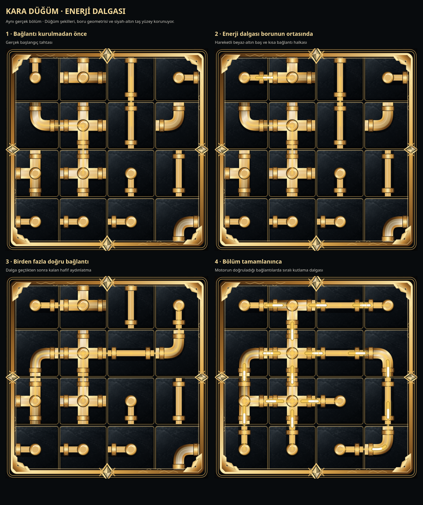

# KARA DÜĞÜM — 3. tasarım: ENERJİ DALGASI

**Yalnız görsel ve animasyon önizlemesidir. Yeni oyun TEST APK’sı veya AAB oluşturulmadı; main’e birleştirilmedi.**

Kaynak: `design/pipe-energy-contrast-test-20261119` / `2917234`. Yeni dal: `design/energy-wave-preview-20261119`. Test edilen oyun çizim kodu: `6aae00950f772c02c065d4cb12af88dea9632a4f`.

[12 saniyelik MP4 videoyu aç](energy-wave-12s.mp4) · [Dört büyük tahta görüntüsünü birlikte aç](four-states.png) · [Yerel video ve görsel galerisi](comparison.html)

## Büyük görseller

1. [Bağlantı kurulmadan önce — tam ekran](01-before.png) · [büyük tahta](01-before-board.png)
2. [Enerji dalgası borunun ortasındayken — tam ekran](02-wave-middle.png) · [büyük tahta](02-wave-middle-board.png)
3. [Birden fazla doğru bağlantı, dalga sonrası hafif ışık — tam ekran](03-connected.png) · [büyük tahta](03-connected-board.png)
4. [Bölüm tamamlandığında sıralı güçlü dalga — tam ekran](04-completion.png) · [büyük tahta](04-completion-board.png)

## Gerçek oyun motoruyla nasıl üretildi?

Görsellerin tamamı **aynı gerçek Bölüm 1** üzerinde ilerleyen oyun durumlarından alındı. Temsili çizim, yeniden üretilmiş taş/boru görseli veya sahte çözülmüş tahta kullanılmadı. Geometriler, maskeler ve doğrulanmış karşılıklı uçlar mevcut oyun motorundan okunuyor.

Video **12 saniye, H.264 MP4, 860×1864, 24 fps**. Gerçek tıklamalarla bağlantı kuruluyor, dalga ilerliyor, bağlı borularda hafif ışık kalıyor, bağlantı koparılıp gerçek Geri Al ile geri getiriliyor. Sonunda yalnız okunur bir yön bulucunun hesapladığı düğüm dönüşleri gerçek oyun tıklamalarına uygulanıyor; kazanma durumunu mevcut motor belirliyor. İpucu kullanılmıyor ve ipucu kuponu tüketilmiyor. Oyunun çözüm dizisi veya kilitli durumu test tarafından atanmadı.

Kayıt aracı, kısa efekti doğru karelerde yakalayabilmek için **test saatini ve yeterli donanım özelliklerini kontrol ediyor**. Video hızı test zaman çizelgesidir; fiziksel telefon FPS ölçümü veya POCO kaydı değildir. Oyuncu verileri yalnız test tarayıcısında oluşturulmuş sentetik kayıtlardır.

## Tasarım ve davranış

- Siyah taş dokusu, altın metal yüzey, düğüm şekilleri ve boru yönleri değişmedi. Oyun tarafındaki değişiklikler yalnız `pipe-flow.js` ve `pipe-flow.css` dosyalarıdır.
- **1.600 ms** boyunca borunun merkezini ve kıvrımını izleyen belirgin beyaz-altın dalga başı, kısa altın kuyruk ve hafif yerel ışık yayılması kullanılıyor. Tüm boru aynı anda güçlü biçimde yanmıyor.
- Dalga doğrulanmış bağlantı aralığından geçerken kısa bir altın halka oluşuyor. Halkalar bağlantısız uçlarda veya yanlış borularda üretilmiyor.
- Bağlantı korunduğunda hafif ışık kalıyor; sürekli animasyon döngüsü çalışmıyor. Bağlantı bozulunca yönü değişmeyen komşunun eski hattı en çok **240 ms** içinde sönüyor. Döndürülerek ortadan kalkan geometri derhâl kaldırılıyor; taşın üzerinde hayalet çizgi kalmıyor.
- Tamamlanma motorun mevcut kazanma kaydından alınır. Dalga bağlı ağlar içinde sıralanır ve en çok **2.200 ms** sürer. Normal yeni-bağlantı dalgaları bu sırada bastırılarak kutlama sırasına karışmaz.
- Tamamlanma dalgası görülebilsin diye mevcut sonuç paneli bu kısa süre boyunca görsel olarak bekletilir; dalga bitince aynı panel açılır. Ödülün verilme zamanı veya hesabı değişmez. Işık kapalı, hareket azaltılmış veya düşük donanım durumunda bu bekleme yoktur.
- Işık İzi kapalıyken ek enerji katmanı, dalga ve halkalar kaldırılır. Hareketi azalt/düşük donanımda yalnız sabit, hafif bağlantı ışığı kullanılır.
- Altı temanın mevcut metal/taş paleti korunur; enerji temanın mevcut rengini ve beyaz çekirdeğini kullanır.
- Parçacık motoru, bulanıklık filtresi veya yeni oyun görseli eklenmedi. Mevcut sınırlı Canvas çizimi kullanılır; yoğun tahtalarda en çok 20, diğer tahtalarda 30 çizim/saniye hedeflenir.

## Test sonuçları

- **300 bölüm:** 18 mevcut kaynak testi başarılı; çözülebilirlik, gerçek ipuçları, bulmaca kuralları, kayıt/bulut modelleri ve ekonomi kontrolleri. Ek dalga testinde 300 tahtanın bağlantıları gerçek motor maskeleriyle karşılaştırıldı.
- **Altı tema:** Kadim Taş, Gece Tapınağı, Çöl Harabeleri, Gece Moru, Zümrüt Mabedi ve Yakut Ateşi. Her birinde bağlantı kurma/koparma, doğru dalga yönü, halka, Geri Al, ayardan aç/kapat ve cüzdan korunması başarılı.
- **Piksel kanıtı:** Aynı oyun durumunun enerji açık ve yalnız Canvas gizli görüntüleri karşılaştırıldı. Altı temada görünür beyaz çekirdek doğrulandı; izin verilen dar boru/halka alanının dışında değişiklik oranı %0. Enerji olmayan negatif kontrol reddedildi. Yalnız tetiklenme sayacına bakılmadı.
- **Hareketi azalt/düşük donanım:** Sabit ışık; hareketli baş/halka yok; boşta çalışan animasyon döngüsü yok; sonuç paneli bekletilmiyor.
- **Ses/titreşim ve öğretici:** 8 UX test grubu ile öğretici regresyonu başarılı. 25 dilde 204 öğretici yerleşimi, 60 tahta boyutu karşılaştırması. Kaynak ses, titreşim, öğretici ve kayıt dosyaları değişmedi. Fiziksel motor/hoparlör doğrulaması değildir.
- **7×7/8×8 sentetik performans:** 1×/4× CPU yavaşlatmalı Chromium’da çizim p95 en çok **6,2 ms**, en uzun çizim örneği **8,8 ms**; tamamlanma dalgaları sonlandı. Fiziksel Android akıcılık/ısı/batarya ölçümü değildir.
- **Geniş tarayıcı regresyonu:** 43 mevcut test grubu başarılı; altı tema/1.800 gerçek tema-tahta durumu, kayıt/bulut, mağaza, ödüller, dil/RTL, 400 obsidyen karşılaştırması ve 1.200 hizalama durumu. **Android 35 WebView:** Altı temada gerçek Native tahta dokunuşları, bağlantı/kopma, Geri Al, Işık İzi kapatma/açma, sıralı tamamlanma ve hareketi azalt kontrolleri başarılı. [Başarılı çalışma](https://github.com/MhmTBsr60/KaraDugum/actions/runs/44498630207).

## Android ve sınırlar

Android test commit’i: `06055b18f7d93223128da6f33ba63f55076ec0a8`. Test edilen çizim dosyaları önizleme dosyalarıyla birebir eşittir.

Android kontrolü, emülatörün sistem imajında zaten bulunan genel WebView kabuğunda gerçek kaynak sayfasını açar. Yeni oyun APK’sı derlenmez, paketlenmez veya kurulmaz. Bu kontrol kaynak çiziminin Android WebView uyumluluğunu araştırır; oyunun APK içi paketlenmesini veya mevcut Native köprüyü yeniden doğrulamış sayılmaz.

Gerçek Android Surface görüntülerinde **93 beyaz çekirdek pikseli**, iki kare arasında **44,7 piksel görünür ilerleme** ve statik ışık açık/kapalı karşılaştırmasında **5.323 değişen piksel** doğrulandı. Dar boru/halka alanı dışındaki değişim **%0**; ışıksız negatif kontrol reddedildi. Yerleşim koordinatları kabuğun adres çubuğunu da içeren gerçek Native WebView sınırlarından hesaplandı. Test zamanlaması ve yeterli donanım özellikleri kontrollüdür; hareketi azalt tercihi CDP üzerinden benzetilmiştir. Düşük donanım statik yolu ayrıca Chromium’da 2 çekirdek/bellek tercihiyle sınanmıştır; ekranlar gerçek Android kompozitöründen `screencap` ile alındı. Tahta dönüşü/Geri Al Native dokunuşla, testte sonuçtan Tekrar Oyna ile çıkış ise mevcut Tekrar Oyna düğmesinin DOM tıklamasıyla yapıldı.

**Fiziksel POCO testi yapılmadı.** Canlı reklam, Google hesabı, gerçek bulut servisi ve fiziksel ses/titreşim bu görsel önizlemenin kapsamı dışındadır; kaynakları korunmuştur.

Hazine tasarımının `design/daily-treasure-preview-20261119` dalı ve `10d5c86` commit’i değiştirilmedi. Mevcut birleşik TEST dalı, main, Google Play üretim 6.50, AdMob hesabı, diğer uygulamalar ve mağaza görsellerine dokunulmadı. Bu dal, kullanıcının belirttiği `2917234` kaynağından ayrı bir çalışma alanında açıldı; Hazine çalışmasının üzerine yazılmadı.

## Kanıt dosyaları

- [Gerçek sahne durumları ve video zaman çizelgesi](preview-state.json)
- [Dalga/300 bölüm/altı tema test raporu](wave-audit.json)
- [Görüntü görünürlüğü ve sınırlı ışık yayılması](pixel-proof.json)
- [Sentetik performans](performance.json)
- [Kaynak testi](test-logs/kd-energy-wave-source.log), [ses/titreşim ve UX](test-logs/kd-energy-wave-ux.log), [öğretici](test-logs/kd-energy-wave-tutorial.log)

- [43 tarayıcı test grubunun günlüğü](test-logs/kd-energy-wave-browser.log)

- [Android WebView sonuçları](android-webview/webview-report.json), [gerçek Surface piksel kanıtı](android-webview/surface-proof.json), [Android dalga görüntüsü](android-webview/wave-middle.png)
- [Değiştirilmeyen kaynak dosyalarının özetleri](protected-source-proof.json)
