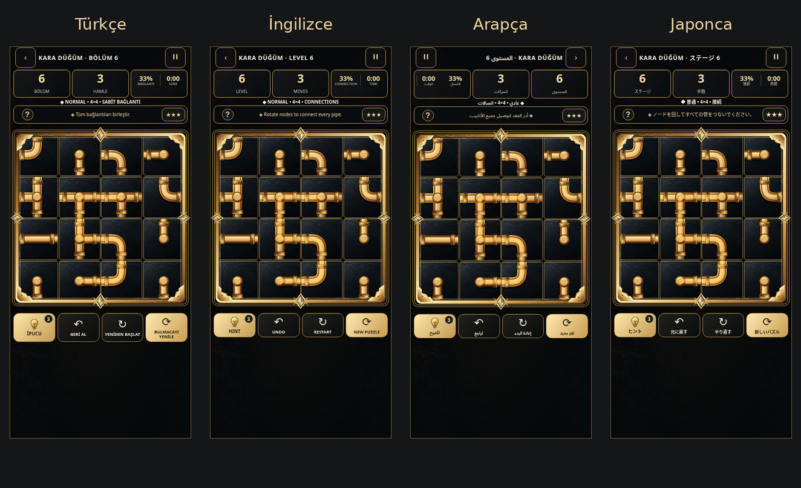
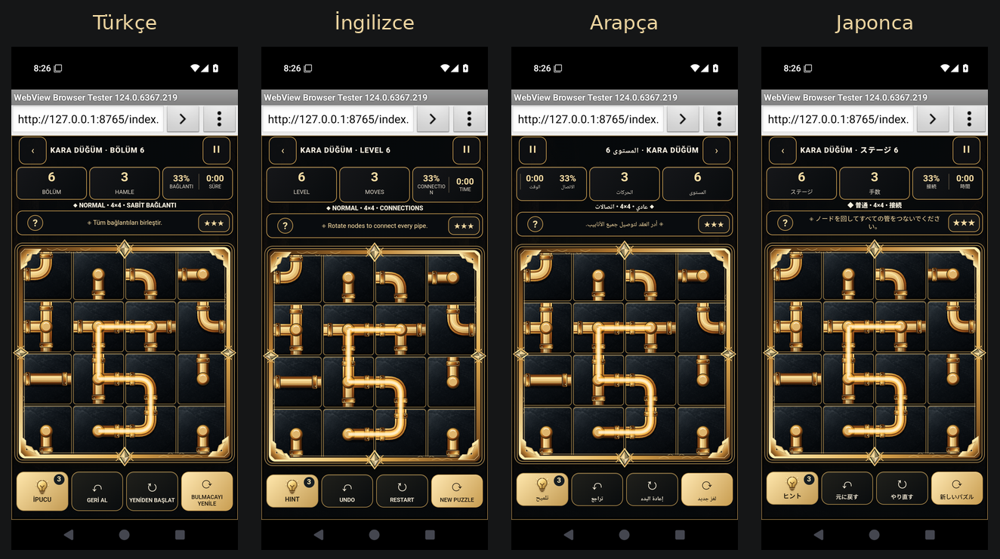

# KARA DÜĞÜM dil değişimi ve görsel tutarlılık denetimi

Denetimin tabanı TEST3 teslimi `14f9038`. Tarayıcı ekran görüntüleri Bölüm 6'nın 4×4 tahtasında, Kadim Taş temasında ve üç hamleden sonraki aynı durumda alındı. Senaryolar örnek oyuncu verileriyle çalıştırıldı.

## Bulgular

| Bulgu | Etkilenen diller | Tür | Sonuç |
| --- | --- | --- | --- |
| Ayarlardan dil seçimi WebView belgesini yeniden yüklüyordu. | 25 yerleşik dil ve Telefon dili seçeneği | Hata | Yeni dil aynı belgede uygulanıyor. Tahta ve ilk düğümün DOM kimliği korundu. Canlı geçişten sonra gerçek Geri Al hamlesi çalıştı. |
| Dört alt oyun kontrolü sağdan sola arayüzde ters fiziksel sıradaydı. | Arapça, Urduca, Farsça | Hata | İpucu, Geri Al, Yeniden Başlat ve Bulmacayı Yenile aynı fiziksel sırada kalıyor. Yardım ve yıldız butonları da konumlarını koruyor. Tahta ve boruların yönü zaten sabitti. |
| Mağaza afişindeki gömülü Türkçe yazı, seçilen dilin metniyle örtülüyor. | Türkçe dışındaki 24 yerleşik dil ve İngilizceye dönen cihaz dili girdileri | Kasıtlı yerelleştirme | Aynı afiş resmi ve aynı görsel kırpma kullanılıyor. Türkçede özgün yazı görünüyor. |
| Metin yönüyle birlikte bazı gezinme öğeleri ve görev görselinin yerleşimi değişiyor. | Arapça, Urduca, Farsça | Kasıtlı RTL düzeni | Yazı sağdan sola okunuyor. Görev çiziminin kaynağı ve dönüşü aynı. Sağdan sola düzen tahtaya, boru yönlerine veya oyun kontrollerinin sırasına uygulanmıyor. |
| Yerleşik dil seçicisinde 25 dil bulunuyor. | Aşağıdaki 17 cihaz dili girdisi | Kapsam farkı | `Telefon dili` ile İngilizce arayüz doğrulandı. Bu girdiler için yerleşik çeviri kapsamı doğrulanamadı. |

## Tarayıcıda doğrulananlar

- 25 yerleşik arayüz dili ve altı tema için 150 canlı karşılaştırmada tahta konumu, boru maskeleri ve SVG yolları, taş yüzeyi, renkler, arka plan, enerji bağlantıları ve kontrol sırası korundu.
- Aynı bulmacanın düzeni, kayıtlı çözümü, zorluk ölçüleri, hedefleri ve hamle sayacı eşit kaldı. Bölüm ilerlemesi, tamamlanan bölümler, en iyi skorlar, kristaller, ipucu kuponları, XP, açık tema ve sahip olunan altı tema korundu. Her yerleşik dilde sayfa yeniden açıldıktan sonra aynı kayıt doğrulandı.
- Hazine, şans çarkı, sandık, mağaza, görevler ve ana menüde görünen görseller yüklendi. Çarkın sekiz dilimi ve Hazine'nin yedi günlük sırası korundu. Çarkın değişen etiketleri ve dükkânın çevrilen afiş metni dil davranışına uygun.
- 42 dil girdisinde gerçek bir hamle yeni bağlantı oluşturdu. Dalganın boru boyunca ilerlediği Canvas piksellerinden ve animasyon durumundan doğrulandı. Ardından dalga sonlanıp kalıcı aydınlatma kaldı.
- 17 ek cihaz dili girdisi bu çalışma için seçildi. Önceki 42'lik listenin kaynağı bulunamadı. Her cihaz girdisi ayrı oturumda açıldı. Bu 17 girdinin ekran görüntüsü, İngilizceye geri dönüşü gösteriyor.

**Yerleşik diller** `tr en zh hi es ar fr bn pt ru ur id de ja mr vi te ha ta pa sw tl fa ko jv`

**İngilizceye geri dönen cihaz dili girdileri** `it nl pl uk th ms ro el he sv da fi no cs hu sk bg`

[42 tarayıcı ekran görüntüsü](web) · [Otomatik tarayıcı sonuçları](browser-report.json)



## Android WebView ekran görüntüleri

Android 15 / API 35 emülatöründe sistem WebView 124 ile Türkçe, İngilizce, Arapça ve Japonca doğrulandı. Dört dilde canlı geçiş ve sayfayı yeniden açma aynı tahta, çözüm, kayıt ve kontrol sırasını korudu. WebView süreci tamamen durdurulup açıldığında Japonca ve aynı aktif bulmaca geri geldi. Ekran görüntüleri 720×1600, oyun görünüm alanı 360×611 CSS pikseli. Bu alanda İngilizce bağlantı etiketi iki satıra ayrılıyor ve Japonca açıklama ikinci satıra iniyor. Her iki ekranda tahta ve dört kontrol görünür.

[Türkçe](android/android-tr.png) · [İngilizce](android/android-en.png) · [Arapça](android/android-ar.png) · [Japonca](android/android-ja.png) · [Yeniden açılış](android/android-ja-yeniden-acilis.png) · [WebView test çıktısı](android/webview-report.json) · [Android 35 çalıştırması](https://github.com/MhmTBsr60/KaraDugum/actions/runs/44702240118)



## Regresyon sonuçları

| Kontrol | Sonuç |
| --- | --- |
| `npm test` | Geçti. 300 bölüm denetlendi, 300 bölüm gerçek ipucu hamleleriyle tamamlandı. |
| `npm run test:browser` | Geçti. 300 bölümün altı teması, kayıt, bulut, görev, mağaza, çark, ekonomi, ses/titreşim tercihleri ve tahta hizası denetlendi. |
| `npm run test:tutorial` | Geçti. İlk açılış, mevcut oyuncu, atlama, tamamlama, yeniden gösterme, 25 dil ve 204 öğretici yerleşimi denetlendi. |
| TEST3 boru içi enerji | Geçti. 300 bölümde gerçek bağlantı grafiği, altı temada dalga, bağlantıyı ayırma, Geri Al ve Işık İzi anahtarı doğrulandı. |
| TEST3 günlük giriş ödülü | Yalıtık tekrarlarda geçti. İlk eşzamanlı koşularda kesinti sonrası pencere sayımı başarısız oldu. TEST3 tabanı ve denetim dalı art arda ikişer kez geçti. Tek ödeme ve aynı gün yeniden gösterimin engellenmesi doğrulandı. |
| Korunan kaynaklar | Oyun motoru, bulut ve ekonomi kaynakları, varlıklar, Android kimliği ve TEST3 paketi üzerinden yapılan fark kontrolü değişiklik göstermedi. |

Fiziksel telefon testi bu denetimin dışında. Android koşusu kaynak oyunu sistem WebView kabuğunda doğruluyor. Bulut ve ödül testleri örnek hesaplar ve yerel kayıtlarla çalıştı.

## Tekrarlama

Bir terminalde depoyu yerel HTTP üzerinden sun. İkinci terminalde Chromium ile denetimi çalıştır.

```sh
python3 -m http.server 8766 --bind 127.0.0.1
```

```sh
npm ci --ignore-scripts
npx playwright install chromium
node tests/locale-visual-audit.cjs
```

Android testi `locale-visual-webview.yml` iş akışında sistem WebView kabuğuyla çalışıyor. Oyun kaynağını HTTP üzerinden yükleyip emülatörün gerçek ekranından PNG alıyor.
